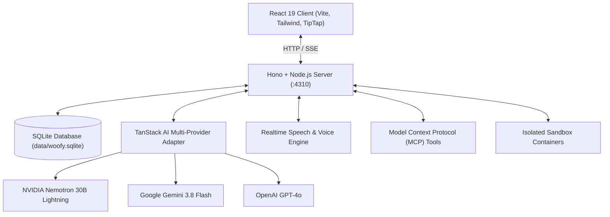

<div align="center">

# 🐶 Woofy

### Autonomous Personal AI Workspace & Multi-Agent Platform

**A powerful, self-hosted AI workspace with persistent multi-specialist agents, real-time voice, containerized computer control, and multi-provider intelligence.**

[](./LICENSE)
[](https://www.typescriptlang.org/)
[](https://react.dev/)
[]()

[Features](#key-features) • [Multi-Provider Setup](#multi-provider-ai-configuration) • [Architecture](#architecture) • [Quickstart](#quickstart) • [Scripts](#available-scripts) • [License](#license)

</div>

---

## 🌟 Key Features

* ⚡ **Multi-Provider AI Intelligence**: Seamlessly switch between NVIDIA Nemotron (Lightning 30B & Ultra 550B), Google Gemini 3.8 Flash, and OpenAI GPT-4o with zero code changes.
* 🛡️ **Local Standalone Mode**: Fully self-contained local state with SQLite (`data/woofy.sqlite`) and in-memory execution. Zero external runtime dependencies required for core chatting and page management.
* 🗣️ **Real-Time Voice & Speech**: Have natural spoken conversations with Woofy. Real-time audio streams directly to your persistent agent.
* 📁 **Spaces & Interactive Document Canvas**: Work directly in collaborative Spaces with rich Markdown document authoring, slash commands, revision history, and Human-in-the-Loop review cards.
* 🤖 **Multi-Specialist Agents**: Create custom agents (Woofys) with specialized system instructions, dedicated spaces, and granular tool permissions.
* 💻 **Containerized Computer Sandboxes**: Equip agents with dedicated, sandboxed browser sessions, shell execution, and persistent file workspaces.
* 🔌 **Model Context Protocol (MCP) & Composio**: Connect external tools via open standard MCP servers and Composio app integrations (Gmail, GitHub, Linear, Slack, etc.).

---

## ⚡ Multi-Provider AI Configuration

Woofy allows you to select your preferred LLM provider in `.env` via `AI_PROVIDER`:

```env
# Choose: 'nemotron', 'gemini', or 'openai'
AI_PROVIDER=nemotron
```

### 1. NVIDIA Nemotron (Ultra-Fast 1.8s Response)
* **Model**: `nvidia/nemotron-3.5-lightning-30b-a3b`
* **Features**: Sub-2s latency, high precision, 1000 free inference credits on [build.nvidia.com](https://build.nvidia.com/).
* **Setup**:
  ```env
  NVIDIA_API_KEY=nvapi-...your_nvidia_key
  NVIDIA_MODEL=nvidia/nemotron-3.5-lightning-30b-a3b
  NVIDIA_BASE_URL=https://integrate.api.nvidia.com/v1
  NVIDIA_ENABLE_THINKING=false
  ```

### 2. Google Gemini (Massive Context & Speed)
* **Model**: `gemini-3.8-flash`
* **Features**: Ultra-fast responses, massive token window, free tier available on Google AI Studio.
* **Setup**:
  ```env
  GEMINI_API_KEY=AQ...your_gemini_api_key
  GEMINI_MODEL=gemini-3.8-flash
  GEMINI_BASE_URL=https://generativelanguage.googleapis.com/v1beta/openai/
  ```

### 3. OpenAI / OpenRouter
* **Model**: `gpt-4o`, `o3-mini`, or any OpenAI-compatible endpoint.
* **Setup**:
  ```env
  OPENAI_API_KEY=sk-...your_openai_key
  OPENAI_MODEL=gpt-4o
  OPENAI_BASE_URL=https://api.openai.com/v1
  ```

---

## 🏗️ Architecture



---

## 🚀 Quickstart

### Prerequisites
* **Node.js**: v24.0.0 or higher
* **npm**: v10+

### Installation

```bash
# 1. Clone the repository
git clone https://github.com/nitinkardam/woofy.git
cd woofy

# 2. Install dependencies
npm install

# 3. Configure environment
cp .env.example .env
```

Open `.env` and set your preferred AI API key (`NVIDIA_API_KEY` or `GEMINI_API_KEY` or `OPENAI_API_KEY`).

### Run Development Server

```bash
npm run dev
```

Open your browser at **http://127.0.0.1:5173** to start using Woofy!

---

## 🛠️ Available Scripts

| Script | Purpose |
|---|---|
| `npm run dev` | Runs backend server and Vite frontend concurrently with hot-reload |
| `npm run build` | Builds client assets (`dist/client`) and compiles TypeScript server (`dist/server`) |
| `npm start` | Launches the production-compiled server |
| `npm run typecheck` | Validates TypeScript types across the entire project |
| `npm test` | Runs the automated Vitest test suite |
| `npm run format` | Formats all code using Prettier |

---

## 📄 License

This project is licensed under the [MIT License](LICENSE) © 2026 Nitin Kardam.
